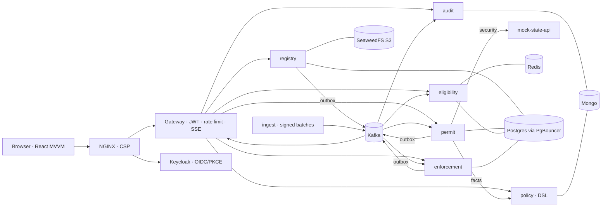

# IPP – Israel Permit Program (DEMO)

מערכת לניהול היתרי כניסה, רישיונות תעסוקה, מדיניות (חוקות ב-DSL), בדיקת זכאות במעבר, ואכיפה עם סגירת מעגל. בנויה לעבוד ברשת סגורה. **כל הנתונים בדויים (MOCK).**

## התחלה מהירה (Windows)
דרישות: Docker Desktop (WSL2), Node 20 ומעלה, Git Bash. **אין צורך** ב-Java או ב-Maven, כי הכול נבנה בתוך Docker.

```powershell
./ipp.ps1 up      # בפעם הראשונה כ-5–10 דקות (הורדות). אחר כך כ-2 דקות
./ipp.ps1 smoke   # 56 בדיקות מקצה לקצה. אמור להסתיים ב-"56 passed, 0 failed"
```
ב-WSL או ב-Git Bash: `make up` ואחריו `make smoke`. השמות של כל הפקודות זהים.

## כתובות
| מה | כתובת | כניסה |
|---|---|---|
| **האפליקציה** | http://localhost | משתמשי דמו (למטה) |
| **Grafana** (דשבורד ניטור) | http://localhost:3000 | צפייה בלי סיסמה. ניהול: `admin` / `dev_grafana_admin` |
| Prometheus | http://localhost:9090 | – |
| Kafka UI | http://localhost:8085 | – |
| Keycloak admin | http://localhost/auth/admin | `admin` / `dev_kc_admin` |
| Swagger לכל שירות | http://localhost:8081/swagger-ui.html (registry), 8082 (permit), 8083 (policy), 8084 (enforcement), 8086 (audit), 8090 (mock-state) | – |

## משתמשי דמו (סיסמה לכולם: `Passw0rd!`)
`officer1` (איש מעבר) · `clerk1` (פקיד) · `worker1` (עובד) · `driver1` (נהג) · `employer1` (מעסיק) · `policy1` (מנהל מדיניות) · `enforcer1` (קצין אכיפה) · `auditor1` (מבקר) · `admin1` (מנהל מערכת)

| ת"ז לבדיקה במעבר | תוצאה |
|---|---|
| 900000001 | ✔ מאושר (היתר עבודה בתוקף) |
| 900000003 | ✖ סנקציה פעילה |
| 900000004 | ⚠ הפנייה לפקיד (בדיקה ביטחונית בהמתנה) |
| 900000005 | ✖ אין היתר. אחרי `./ipp.ps1 batch` נפתח לו תיק אכיפה אוטומטית |

## פקודות
| פקודה | מה היא עושה |
|---|---|
| `up` / `down` | הפעלה ועצירה (המידע נשמר) |
| `reset` | מחיקה מלאה של המידע. ה-seed ייווצר מחדש ב-`up` הבא |
| `smoke` | בדיקת מערכת מלאה מול ה-stack הרץ |
| `verify` | lint, בדיקות יחידה (Java ו-React), בדיקת סודות ו-build. חובה לפני commit |
| `perf` | k6: 200 בקשות לשנייה למשך 60 שניות על בדיקת הזכאות |
| `batch [--tamper\|--badsig]` | חבילת קליטה חתומה ל-`ingest/inbox` (קבצים פגומים עוברים ל-quarantine) |
| `chaos on\|off` | מפיל את ממשקי המדינה (mock), כדי לראות circuit breaker |
| `logs <service>` / `ps` | לוגים וסטטוס |

## ארכיטקטורה בקצרה

- **הנתיב החם:** בדיקה במעבר עוברת דרך eligibility ל-Redis, ובמקרה של miss ל-read-model ב-Postgres. **אין קריאה סינכרונית לשירות אחר.** p95 של 20ms ב-200 בקשות לשנייה.
- **סגירת מעגל:** חבילה חתומה עוברת ingest, Kafka ו-enforcement (הפרה, תיק, סנקציה), ובסוף eligibility מחזיר אדום. ערעור מסיר את הסנקציה.

## מסלול לימוד מומלץ (בסדר הזה)
1. **להריץ את הדמו לפי** [docs/DEMO_SCRIPT.md](docs/DEMO_SCRIPT.md). הוא מראה כל תפקיד בעשר דקות.
2. **מושגים ותהליך הבנייה:** [docs/WORKLOG.md](docs/WORKLOG.md). כל שלב עם הסבר בעברית ו"באגים ידועים".
3. **ההחלטות ולמה:** [docs/adr/](docs/adr/). שבעה ADRs: bounded contexts, SeaweedFS, outbox, Postgres tuning, רשת סגורה, DSL, ingest.
4. **קוד, מהפשוט למורכב:**
   - `services/eligibility-service/.../domain/Eligibility.java`: כללי ההחלטה, Java טהור.
   - `services/eligibility-service/.../application/EligibilityService.java`: Redis, single-flight ו-metrics.
   - `libs/java-common/.../outbox/`: Transactional Outbox.
   - `services/permit-service/.../domain/Permit.java`: מכונת המצבים של ההיתר.
   - `services/policy-service/`: ה-DSL (ANTLR), נכתב על ידי סוכן הענן.
   - `apps/web/src/features/crossing/`: MVVM, דרך `model` ואז `viewmodel` ואז `view`.
5. **לצפות בה חיה:** Grafana בזמן `./ipp.ps1 perf`, ו-Kafka UI בזמן `./ipp.ps1 batch`.
6. **מה חסר לפרודקשן:** [docs/GAPS.md](docs/GAPS.md).

מסמכים נוספים:
- [docs/SPEC.md](docs/SPEC.md): אפיון.
- [docs/CONFIG_REFERENCE.md](docs/CONFIG_REFERENCE.md): פורטים ושינויי קונפיגורציה.
- [docs/CLOSED_NETWORK.md](docs/CLOSED_NETWORK.md): העברה לרשת סגורה.
- [CLAUDE.md](CLAUDE.md): כללי הקוד.

## תקלות נפוצות
| תופעה | פתרון |
|---|---|
| פורט 80 תפוס | לעצור IIS/Skype/שרת אחר, או לשנות ב-`compose.yaml` (שירות `nginx`) |
| המחשב איטי או Docker נתקע | `docs/setup/wslconfig.example` כבר הועתק ל-`%UserProfile%\.wslconfig`. כדי שייכנס לתוקף: `wsl --shutdown` ואז לפתוח מחדש את Docker Desktop |
| שירות לא עולה (`unhealthy`) | `./ipp.ps1 logs <service>`. בדרך כלל זה זמן עלייה: לחכות ולהריץ שוב `./ipp.ps1 up` |
| התחברות מחזירה לדף הבית בלי משתמש | לנקות cookies של localhost, או לפתוח חלון incognito |
| הבדיקה הראשונה איטית | JVM קר. אחרי כמה בקשות זה מתייצב על כמה ms |
