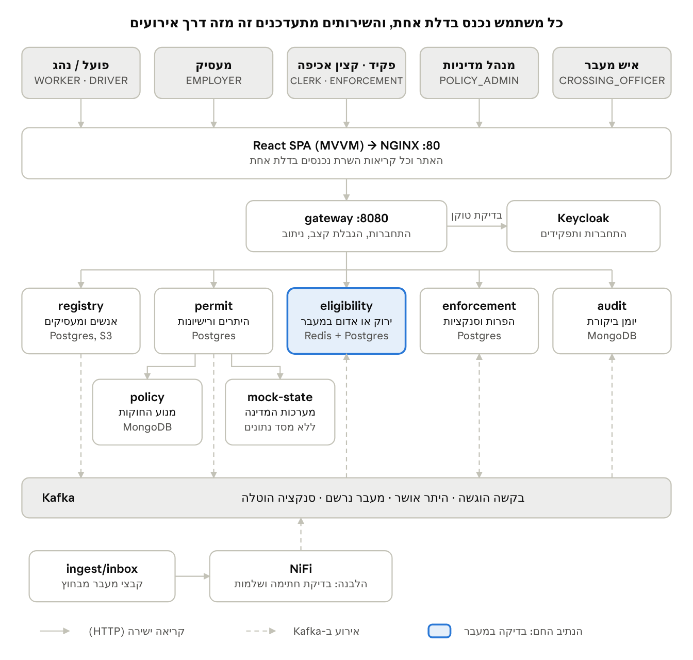

# קבצי הגדרות בפרויקט

> העותק ב-repo של המסמך "קבצי הגדרות בפרויקט" מ-claude.ai. מעודכן ל-20/11/2026 16:45.
> לקבצים עצמם: `services/<name>/src/main/resources/application.yaml`, `infra/`, `compose.yaml`, `.env.example`.

## סקירה
- **קובצי הגדרות:** לכל שירות יש קובץ אחד, `application.yaml`. לתשתית יש קבצים בתיקייה `infra/`. הכל מחובר דרך `compose.yaml` ו-`.env`.
- **כלל ההערות:** כל ערך שהשתנה מברירת המחדל מסומן בקוד בהערה `[MANUAL CHANGE – Marom]`, עם ברירת המחדל המקורית והסיבה לשינוי. `scripts/check-config-comments.sh` אוכף את זה ב-verify.
- **סודות:** אין סיסמאות בקבצים. כל סיסמה מגיעה ממשתנה סביבה. ב-repo יש רק `.env.example` עם ערכי דמו.

## איפה כל קובץ הגדרות נמצא
כל הנתיבים יחסיים לשורש ה-repo. בקבצים שמסומנים ב-★ יש ערכים עם `[MANUAL CHANGE – Marom]`.

| קובץ | שייך ל | מה יש בו |
|---|---|---|
| `compose.yaml` | כל המערכת | קונטיינרים, פורטים, תקרות זיכרון ו-CPU, פרופילים (core / ingest / nifi) |
| `.env.example` | כל המערכת | משתני סביבה עם ערכי דמו. מעתיקים ל-`.env`, שלא עולה לגיט |
| `services/gateway/src/main/resources/application.yaml` | gateway | ניתוב, Keycloak (JWT), rate limit מול Redis |
| `services/registry-service/src/main/resources/application.yaml` ★ | registry-service | DB דרך PgBouncer, Hikari, Kafka, SeaweedFS |
| `services/permit-service/src/main/resources/application.yaml` ★ | permit-service | DB, Hikari, Kafka, כתובות policy ו-mock, circuit breaker |
| `services/eligibility-service/src/main/resources/application.yaml` ★ | eligibility-service | DB, Hikari, Redis (TTL), Kafka consumer |
| `services/enforcement-service/src/main/resources/application.yaml` ★ | enforcement-service | DB, Hikari, Kafka, תזמון בדיקת "נכנס ולא יצא" |
| `services/audit-service/src/main/resources/application.yaml` | audit-service | MongoDB, Kafka consumer, תיקיית quarantine |
| `services/policy-service/src/main/resources/application.yaml` | policy-service | MongoDB, החוקות ההתחלתיות |
| `services/mock-state-api/src/main/resources/application.yaml` | mock-state-api | seed, הזרקת תקלות |
| `services/ingest-service/src/main/resources/application.yaml` | ingest-service | תיקיות inbox/archive/quarantine, מפתח ציבורי, Kafka |
| `services/<שירות>/src/main/resources/db/changelog/db.changelog-master.yaml` | שירותים עם Postgres | הטבלאות (Liquibase) |
| `libs/java-common/src/main/resources/db/changelog/common.yaml` | כל השירותים | `outbox`, `inbox`, `idempotency_keys` |
| `infra/postgres/postgresql.conf` ★ | PostgreSQL | timeouts, זיכרון, לוג שאילתות איטיות |
| `infra/postgres/init/01-roles.sh` | PostgreSQL | סכמה ומשתמש לכל שירות (בעלייה הראשונה) |
| `infra/pgbouncer/pgbouncer.ini` ★ | PgBouncer | `pool_mode=transaction`, גודל pool |
| `infra/mongo/init-users.js` | MongoDB | משתמש לכל שירות |
| `infra/keycloak/ipp-realm.json` | Keycloak | realm, 9 תפקידים, משתמשי דמו |
| `infra/seaweedfs/s3.json` | SeaweedFS | מפתחות S3 והרשאות |
| `infra/nginx/nginx.conf` · `security-headers.conf` | NGINX | ניתוב `/`, `/api`, `/auth`; כותרות אבטחה |
| `infra/migrate/migrate.sh` | migrate | Liquibase לכל השירותים |
| `infra/ingest/keys/ingest.pub.pem` | ingest-service + NiFi | מפתח ציבורי לבדיקת חתימה (הפרטי ב-`.ingest-keys/`, לא בגיט) |
| `infra/nifi/Dockerfile` · `infra/nifi/flow/ipp-ingest.flow.json` | NiFi | image עם ה-verifier; הזרימה (נוצרת מ-`scripts/ingest/build-nifi-flow.mjs`) |
| `apps/web/vite.config.ts` | פרונט | build ושרת פיתוח |

## מה כל שירות עושה
| שירות | מה הוא עושה, במשפט אחד | דוגמה מהדמו | איפה הנתונים שלו |
|---|---|---|---|
| NGINX | הדלת היחידה למערכת: מגיש את האתר ומעביר בקשות API פנימה | הדפדפן פותח `localhost` ומקבל את האתר | אין |
| gateway | שומר הסף: בודק התחברות, מגביל קצב בקשות ומנתב לשירות הנכון | בקשה ל-`/api/permits` מגיעה ל-permit-service | אין (Redis למונה הבקשות) |
| registry-service | פנקס האנשים והמעסיקים: פרופיל, תמונה, ת"ז, כרטיס מגנטי | הפרופיל של פועל 900000001 עם התמונה שלו | Postgres + תמונות ב-SeaweedFS |
| permit-service | בקשות, היתרים, רישיונות תעסוקה ומכסות, כולל PDF עם QR חתום | פועל מגיש בקשה, פקיד מאשר, ונוצר היתר עם תוקף | Postgres |
| policy-service | מנוע החוקות: מנהל כתיבה וגרסאות של מדיניות, ומחליט מי זכאי ולמה | "פועל בניין מגיל 22 עם סטטוס תקין ומכסה פנויה מקבל 90 יום" | MongoDB |
| eligibility-service | בדיקת זכאות מהירה במעבר: ירוק או אדום תוך מילי-שניות | איש מעבר מקליד ID ומקבל "מאושר" עם תמונה | עותק קריאה ב-Postgres ו-cache ב-Redis |
| enforcement-service | סגירת מעגל: מזהה הפרות, פותח תיק ומטיל סנקציה | פועל נכנס ולא יצא עד סוף התוקף ומקבל מניעת כניסה | Postgres |
| audit-service | יומן ביקורת: כל החלטה במערכת נרשמת ולא ניתנת למחיקה | "מי אישר את ההיתר הזה, מתי, ולפי איזו גרסת חוקה?" | MongoDB (append-only) |
| mock-state-api | מחקה את מערכות המדינה: מרשם, סטטוס ביטחוני, רישום פלילי | מפילים אותו בכוונה ומראים שהמערכת מפנה לפקיד במקום לקרוס | אין (נתונים נוצרים מ-seed) |
| migrate | מריץ פעם אחת בעלייה את שינויי הסכמה של Postgres (Liquibase) | יוצר את הטבלאות לפני שהשירותים עולים | אין |

**איך הם מדברים:** פעולה שהמשתמש מחכה לה עוברת ב-HTTP (REST). שינוי ששירותים אחרים צריכים לדעת עליו (היתר אושר, סנקציה הוטלה) עובר כאירוע ב-Kafka.

## תרשים: איך המידע זורם במערכת

כך קוראים את התרשים מלמעלה למטה:
1. **כניסה:** כל תפקיד נכנס דרך אותו אתר, עובר ב-gateway, שבודק מול Keycloak מי הוא, ומשם ממשיך לשירות הנכון.
2. **בקשת היתר:** permit שואל בקריאה ישירה את policy (האם זכאי?) ואת mock-state (מה הסטטוס הביטחוני?).
3. **הפצה:** כשהיתר אושר, נשלח אירוע ל-Kafka. eligibility מעדכן ממנו את העותק שלו, ו-audit רושם אותו.
4. **מעבר:** איש המעבר מקבל תשובה מ-eligibility בלי שאף שירות אחר מעורב. לכן זה מהיר.
5. **סגירת מעגל:** קבצי מעבר מבחוץ עוברים הלבנה ב-NiFi ונכנסים ל-Kafka. enforcement מזהה מי נכנס ולא יצא, מטיל סנקציה ושולח אירוע, ו-eligibility מתחיל להחזיר אדום.

## פורטים, רשת ותשתית
**התשובה הקצרה:** המשתמש נכנס רק דרך פורט 80 (NGINX). שרת ה-API עצמו (ה-gateway) עובד על 8080 בתוך רשת Docker, ואין לו פורט חיצוני בכלל. כל שירותי ה-Spring עובדים על 8080 בפנים.

- **פורט פנימי:** הפורט שהשירות מאזין לו בתוך הקונטיינר. שירותים מגיעים זה לזה לפי שם ופורט, למשל `permit-service:8080`.
- **פורט במחשב:** פורט שנפתח במחשב שלך ומופנה לפורט הפנימי. כולם קשורים רק ל-`127.0.0.1`, כך שמחשב אחר ברשת לא יכול להגיע אליהם. רובם קיימים רק לדיבאג ול-Swagger.

| רכיב | תפקיד | פורט פנימי | פורט במחשב | למה הפורט הזה | גרסה | זיכרון |
|---|---|---|---|---|---|---|
| NGINX | נקודת הכניסה היחידה | 80 | 80 | הפורט הסטנדרטי של HTTP, אז מספיק לכתוב `localhost`. בפרודקשן: 443 עם TLS | 1.28.0 | 64MB |
| gateway (שרת ה-API) | אימות, rate limit וניתוב | 8080 | אין | ברירת המחדל של Spring Boot. אין פורט חיצוני בכוונה, כדי שאי אפשר יהיה לעקוף את בדיקת ההתחברות ואת הגבלת הקצב | Spring Cloud Gateway | 512MB |
| registry-service | אנשים ומעסיקים | 8080 | 8081 | סדרת 808x לפי הסדר במערכת, קל לזכור. לדיבאג בלבד | Spring Boot 3.5.5 | 512MB |
| permit-service | בקשות והיתרים | 8080 | 8082 | סדרת 808x. לדיבאג בלבד | Spring Boot 3.5.5 | 512MB |
| eligibility-service | בדיקת זכאות | 8080 | אין | רץ בכמה עותקים (`--scale 3`). פורט קבוע במחשב יכול להיות שייך רק לעותק אחד, ולכן הוא נגיש רק דרך ה-gateway, שמחלק ביניהם | Spring Boot 3.5.5 | 512MB לעותק |
| policy-service | מנוע החוקות | 8080 | 8083 | המקום הפנוי בסדרת 808x (eligibility בלי פורט חיצוני). לדיבאג ו-Swagger | Spring Boot 3.5.5 | 512MB |
| enforcement-service | אכיפה וסנקציות | 8080 | 8084 | סדרת 808x לדיבאג | Spring Boot 3.5.5 | 512MB |
| kafka-ui | צפייה באירועי Kafka | 8080 | 8085 | הפורט הפנוי הבא בסדרה, בשביל הדמו | 1.2.0 | 384MB |
| audit-service | יומן ביקורת | 8080 | 8086 | סדרת 808x לדיבאג | Spring Boot 3.5.5 | 512MB |
| mock-state-api | דמה של מערכות המדינה | 8080 | 8090 | מחוץ לסדרת 808x בכוונה: שירות דמה שלא יעלה לפרודקשן. דרכו מפעילים בדמו את הזרקת התקלות | Spring Boot 3.5.5 | 384MB |
| Keycloak | התחברות ותפקידים | 8080 | 8180 | מוסכמה מקובלת ל-Keycloak (8080 + 100), כי 8080 תפוס במחשבי פיתוח. הדפדפן מגיע אליו דרך NGINX ב-`/auth`, והפורט הישיר הוא למסך הניהול | 26.3.3 | 768MB |
| PostgreSQL | מקור האמת | 5432 | אין | הפורט הרשמי של Postgres. לא פתוח למחשב בכוונה: השירותים ניגשים רק דרך PgBouncer | 17.6 | 512MB |
| PgBouncer | מרכז חיבורי DB | 6432 | אין | מוסכמה של הקהילה: פורט Postgres ועוד 1000. כל השירותים מתחברים לכאן ולא ישירות ל-Postgres | build מקומי | 64MB |
| MongoDB | חוקות ו-audit | 27017 | אין | הפורט הרשמי של Mongo. לא פתוח למחשב | 8.0.12 | 512MB |
| Redis | cache ומונה בקשות | 6379 | אין | הפורט הרשמי של Redis. לא פתוח למחשב | 7.4.5 | 128MB |
| Kafka | עמוד השדרה של האירועים | 9092 (לקוחות), 9093 (controller) | אין | 9092 הוא ברירת המחדל של Kafka. 9093 משמש ל-KRaft, ניהול פנימי בלי ZooKeeper | 3.9.1 | 768MB |
| SeaweedFS | אחסון תמונות ומסמכים (S3) | 8333 (S3), 9333 (master) | אין | ברירות המחדל של SeaweedFS: 8333 ל-S3 API ו-9333 לניהול האשכול | 3.97 | 256MB |
| migrate | מיגרציות DB | אין | אין | רץ פעם אחת ונסגר, לא מאזין לשום פורט | Liquibase 4.33.0 | 384MB |
| Prometheus | אוסף מדדים מכל השירותים | 9090 | 9090 → http://localhost:9090 | ברירת המחדל של Prometheus. פרופיל observability | 2.55.1 | 384MB |
| Grafana | דשבורד ניטור (IPP overview) | 3000 | 3000 → http://localhost:3000 | ברירת המחדל של Grafana. צפייה בלי סיסמה, ניהול `admin` / `dev_grafana_admin` | 11.3.0 | 256MB |
| ingest-service | קליטת קבצי מעבר חתומים | 8080 | אין | עובד מול תיקייה ו-Kafka בלבד, אין לו API למשתמש | Spring Boot 3.5.5 | 384MB |
| NiFi | זרימת הלבנה (ZIP חתום) | 8443 | 8443 → https://localhost:8443/nifi | ברירת המחדל של NiFi 2 (HTTPS בלבד). פרופיל nifi | 2.9.0 | 1.5GB |

**כתובות IP:** אין כתובות IP קבועות. כל הקונטיינרים ברשת Docker אחת בשם `ipp`, ו-Docker מתרגם שם של שירות לכתובת שלו (DNS פנימי). כך שירות שעולה מחדש עם כתובת אחרת ממשיך לעבוד, ו-`--scale` מחלק בקשות בין עותקים בלי שינוי הגדרות.

**סך הכל זיכרון:** בפועל נמדדו כ-2.9GB כש-15 קונטיינרים רצים. התקרה המוגדרת ב-compose היא 8GB, ו-WSL מוגבל ל-14GB.

## שינויים ידניים מברירת מחדל
הטבלה מרכזת את כל הערכים המסומנים `[MANUAL CHANGE – Marom]`. זו הרשימה שכדאי להכיר בעל פה לראיון.

| איפה | פרמטר | ברירת מחדל | ערך אצלנו | למה |
|---|---|---|---|---|
| Postgres | `max_connections` | 100 | 200 | מקום ל-PgBouncer, ל-migrate ולכלי ניהול |
| Postgres | `statement_timeout` | 0 (ללא הגבלה) | 30s, ולשירותי web רק 5s | שאילתה תקועה לא תחסום חיבור לנצח |
| Postgres | `lock_timeout` | 0 | 5s | מונע ערימת בקשות שמחכות לאותה נעילה |
| Postgres | `idle_in_transaction_session_timeout` | 0 | 60s | טרנזקציה שנפתחה ונשכחה נסגרת מעצמה |
| Postgres | `idle_session_timeout` | 0 | 0 גלובלי; 10min רק לתפקידים אינטראקטיביים | ערך גלובלי היה מנתק את החיבורים השקטים של PgBouncer |
| Postgres | `shared_buffers` / `work_mem` | 128MB / 4MB | 256MB / 8MB | מותאם לקונטיינר של 512MB |
| Postgres | `effective_cache_size` | 4GB | 1GB | מוקטן, כי הקונטיינר קטן משמעותית |
| Postgres | `log_min_duration_statement` | -1 (כבוי) | 500ms | כל שאילתה איטית נכתבת ללוג |
| Postgres | `shared_preload_libraries` | ריק | `pg_stat_statements` | סטטיסטיקה לכל שאילתה |
| PgBouncer | `pool_mode` | session | transaction | חיבור אמיתי מושאל רק לזמן טרנזקציה אחת |
| PgBouncer | `max_client_conn` / `default_pool_size` | 100 / 20 | 500 / 20 | הרבה שירותים ועותקים מול מעט חיבורים אמיתיים |
| HikariCP (כל שירות) | `connection-timeout` | 30s | 3s | כשל מהיר במקום תור ארוך |
| HikariCP (כל שירות) | `leak-detection-threshold` | 0 (כבוי) | 20s | אזהרה על חיבור שלא הוחזר |
| HikariCP (כל שירות) | `maximum-pool-size` | 10 | 10 (מתועד) | החישוב ב-ADR 0004 |
| Redis | `maxmemory-policy` | noeviction | volatile-lru | מוחק רק מפתחות עם TTL, במקום להחזיר שגיאות כתיבה |
| policy-service | `auto-index-creation` (Spring Data Mongo) | false | true | בלי זה האינדקס הייחודי (name, version) לא נוצר |

## שים לב
נמצאו ארבעה פערי התאמה בין שירותי main לשירותים של סוכן הענן. בלי תיקון, כל בקשת היתר הייתה מופנית לפקיד.
**עדכון 16:40:** הסוכן ב-VS Code התאים את permit-service לחוזה של policy-service. מה שנשאר (סוג היתר DRIVER, שדות ההיתר הרפואי ומספרי הזהות ב-mock) תוקן ב-branch `cloud/align-with-main`.

**שלוש הגדרות שכדאי לדעת להסביר בראיון:**
1. **`prepareThreshold=0`:** במצב transaction, PgBouncer מחליף חיבור אמיתי בין טרנזקציות. prepared statement שנשמר על חיבור אחד לא קיים באחר, וזו שגיאה מוכרת מאוד. ההגדרה מכבה אותם.
2. **`volatile-lru` ב-Redis:** מתאים לכלל "TTL על כל מפתח". כשהזיכרון מתמלא, Redis מפנה מפתחות cache ישנים במקום להיכשל.
3. **Circuit breaker ב-permit-service:** כש-policy-service או ה-mock נופלים, הבקשות מופנות לפקיד (`REFER_TO_CLERK`) ולא מאושרות אוטומטית. זה עקרון fail-safe.
