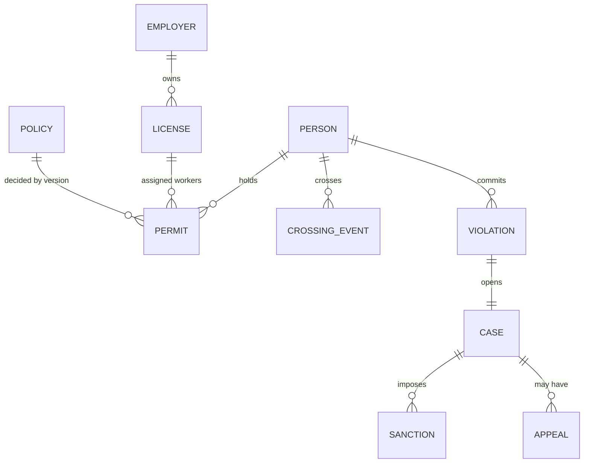

# IPP – אפיון מערכת (SPEC)
> מסמך חי · גרסה 0.1 · 20/11/2026 · כל הנתונים MOCK

## 1. מטרות
1. לנהל היתרים ורישיונות תעסוקה לפי מדיניות מגורסת, בלי deploy.
2. לתת לאיש המעבר תשובת זכאות **מתחת לשנייה** (p95 < 150ms ב-200 RPS).
3. לסגור את מעגל האכיפה: הפרה, תיק, סנקציה, הודעה, ערעור וסגירה. כל שלב מתועד ב-audit.
4. לעבוד ברשת סגורה, בלי שום קריאה החוצה (פרק 9).

## 2. תפקידים
| תפקיד | יכולות עיקריות |
|---|---|
| WORKER | פרופיל אישי, הגשת בקשה, צפייה בהיתר עם QR |
| DRIVER | בקשת היתר נהג או משאית (רכב ומטען) |
| EMPLOYER | בקשת רישיון, שיבוץ עובדים, חיפוש עובדים מאושרים לפי אזור (ABAC: רק העובדים שלו) |
| CROSSING_OFFICER | סריקת QR או הקלדת ID, ותשובה ירוק/אדום עם תמונה וסיבה |
| CLERK | טיפול בבקשות: אישור, דחייה, בקשת מסמכים |
| POLICY_ADMIN | כתיבת חוקות, סימולציה ופרסום |
| ENFORCEMENT_OFFICER | תיקים, סנקציות, ערעורים |
| AUDITOR / SYS_ADMIN | צפייה ב-audit, ניהול, DLT replay |

## 3. User stories מרכזיות (MVP)
- **US-1 (WORKER):** מגיש בקשת היתר עבודה, והשדות נגזרים מהמדיניות.
  **AC:** בטופס מופיעים רק שדות ש-`REQUIRE FIELDS` דורש. הבקשה נשמרת במצב `SUBMITTED`, ומתקבל מספר בקשה.
- **US-2 (CLERK):** מאשר בקשה.
  **AC:** הסטטוס עובר ל-`APPROVED` ואז ל-`ACTIVE`. נפלט אירוע `permits.permit.approved.v1`, ונכתבת רשומת audit.
- **US-3 (CROSSING_OFFICER):** בודק ID.
  **AC:** תשובה תוך פחות מ-500ms מנקודת המבט של המשתמש, עם `decision`, `reasons[]`, `policyVersion` ותמונה. ID עם סנקציה פעילה מקבל אדום.
- **US-4 (POLICY_ADMIN):** מסמלץ חוקה חדשה על 1,000 בקשות.
  **AC:** מתקבלות ספירות שינוי (approve↔refer) ודוגמאות.
- **US-5 (מערכת):** אירוע מעבר "נכנס ולא יצא" אחרי פקיעת ההיתר.
  **AC:** נפתח תיק, מוצעת סנקציה, והבדיקה הבאה מחזירה אדום.
- **US-6 (EMPLOYER):** מחפש עובדים מאושרים באזור.
  **AC:** מוצגים רק העובדים שלו, עם keyset pagination.

## 4. ישויות (ERD)

## 5. מכונות מצבים
- **Permit:** `DRAFT → SUBMITTED → IN_REVIEW → APPROVED | REJECTED`, ואחריו `APPROVED → ACTIVE → EXPIRED | SUSPENDED | REVOKED`.
- **Case:** `OPEN → SANCTION_PROPOSED → SANCTIONED → (APPEALED → UPHELD | OVERTURNED) → CLOSED`.

## 6. APIs (דרך gateway, `/api/<service>/...`)
ה-OpenAPI המלא נמצא ב-`services/<name>/src/main/resources/openapi.yaml`.

- `GET /api/registry/persons/{id}`
- `GET /api/registry/persons?region=&after=`
- `POST /api/permits/applications` (Idempotency-Key)
- `POST /api/permits/applications/{id}/decision`
- `GET /api/eligibility/check/{personId}?purpose=ENTRY|EXIT|WORK`
- `POST /api/policies/{id}/simulate`
- `GET /api/enforcement/cases`
- `POST /api/enforcement/cases/{id}/appeal`
- `GET /api/audit?entityId=`
- `GET /api/events/stream` (SSE)

## 7. אירועים (Kafka, key=personId)
- `registry.person.upserted.v1`
- `permits.permit.approved.v1`
- `permits.permit.status-changed.v1`
- `crossing.event.recorded.v1`
- `enforcement.sanction.imposed.v1`
- `enforcement.sanction.lifted.v1`
- `audit.decision.v1`
- `audit.ingest.v1`

הסכמות נמצאות ב-`contracts/events/*.schema.json`.

## 8. דרישות לא-פונקציונליות
- **ביצועים:** בדיקת זכאות עם p95 < 150ms ב-200 RPS, ו-cache hit מעל 90%.
- **זמינות:** כשה-`mock-state-api` נופל, ה-circuit breaker מחזיר `REFER_TO_CLERK`. השירותים stateless.
- **אבטחה:** OIDC עם PKCE, RBAC ו-ABAC, CSP קשיח, QR חתום ב-Ed25519, ו-audit append-only.
- **נגישות:** WCAG 2.1 AA (ת"י 5568).
- **שפות:** he, en, ru, ar, עם RTL/LTR.
- **משאבים:** פרופיל core עד 8GB RAM.

## 9. רשת סגורה
- **תלויות:** כל התמונות מוצמדות לגרסה. Maven ו-npm עוברים דרך mirror פנימי (`MAVEN_MIRROR_URL`, `NPM_REGISTRY`).
- **העברת חבילות:** `scripts/offline/bundle.sh` מכין את החבילה, ו-`load.sh` טוען אותה בצד השני. הפירוט ב-`docs/CLOSED_NETWORK.md`.
- **הלבנת מידע נכנס:** NiFi מבצע את השלבים: manifest, Ed25519, SHA-256, dedup, סכמה ו-quarantine (ADR 0005, G-04).
- **CA פנימי:** truststore כ-volume, דרך `JAVA_TOOL_OPTIONS=-Djavax.net.ssl.trustStore=...`.
- **NTP:** השעון מגיע מהמארח, שמסונכרן מול NTP ארגוני. השירותים שומרים UTC.
- **אין קריאות יוצאות:** אין CDN ואין טלמטריה. ממשקי המדינה עוברים דרך Ports & Adapters (mock-state-api).
